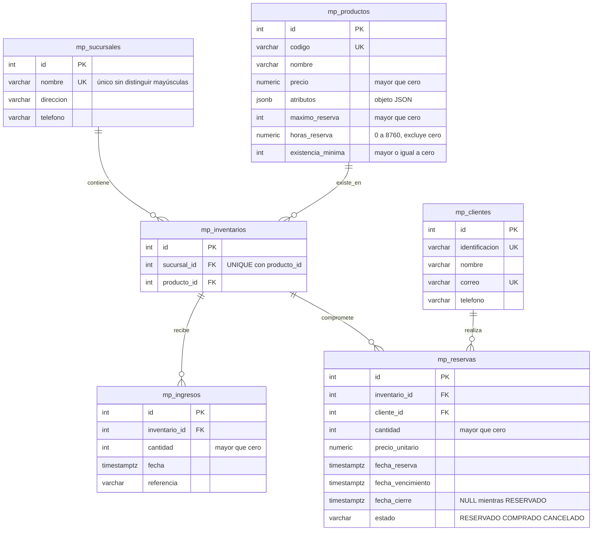

# Modelo de datos de Mi Pulpería de Barrio

Todos los objetos llevan el prefijo `mp_` dentro de `user_07`. Las tablas `PRQ...` existentes no forman parte del proyecto y no se alteran. Las llaves primarias son enteros generados por PostgreSQL. Las relaciones usan `ON DELETE RESTRICT`.

## Restricciones y decisiones

Los ingresos son un historial de solo inserción. Las reservas solo admiten la transición de `RESERVADO` a `COMPRADO` antes del vencimiento o a `CANCELADO` después de él. Los estados finales son inmutables. `UPDATE`, `DELETE` y `TRUNCATE` indebidos se rechazan mediante triggers. La relación sucursal-producto de un inventario también es inmutable para evitar reasignar su historial.

La disponibilidad se calcula como **ingresos − reservas activas − compras**. La cantidad reservada suma solo `RESERVADO`. Cancelar por vencimiento libera unidades por el cambio de estado; comprar conserva el descuento y cambia la clasificación a vendidas. No hay un saldo editable que pueda desincronizarse. Una reserva vencida sigue ocupando unidades hasta que el proceso del segundo entregable la cancele.

Se toma el máximo por cliente y producto en el conjunto de sucursales, dado que el enunciado no lo restringe a una tienda. El trigger bloquea la fila del producto durante cada reserva para serializar decisiones de stock y de límite. La existencia mínima se aplica por producto en cada sucursal. No se permite incrementar ese mínimo por encima del saldo disponible de un inventario existente ni reducir el máximo por debajo de reservas activas.

El precio y plazo se copian al crear la reserva; cambiar un producto no modifica reservas anteriores. Las fechas se almacenan en `timestamptz` y se presentan en horario de Costa Rica. Los tres catálogos usan `xmin` para detectar ediciones concurrentes.

## Vistas

`mp_v_productos_existencias` incluye los atributos y condiciones del producto, la sucursal y sus cantidades disponible, reservada y vendida. Los agregados se calculan por separado para no multiplicar cantidades al unir ingresos y reservas.

`mp_v_reservas_clientes` incluye cliente, sucursal, producto, cantidades, precio histórico, total, fechas, estado y un indicador de compra materializada. La consulta web ordena por fecha descendente e ID descendente.

## Alcance de los permisos

Los triggers protegen las operaciones SQL ordinarias. El propietario del esquema o un administrador puede modificar o deshabilitar triggers; ninguna restricción puede impedir que su propio administrador cambie el diseño. En despliegue se recomienda un rol de aplicación sin permisos de DDL. El rol del proceso calendarizado y la separación de permisos de transición de estado se completarán con los procesos del segundo entregable. No existe una acción de cancelación manual en la interfaz.

La penalización de clientes está marcada como TODO en el enunciado: no se inventa una política de penalización. La existencia mínima sí está implementada y probada.
